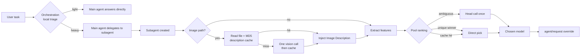

# dsh-model-router

> **Local-first model routing & auto-orchestration for DSH subagents.**
> Put every task on the cheapest model that is still good enough — and pay for a decision only when the local cache misses.

[](LICENSE)
[](https://nodejs.org)
[](https://github.com/deepseek-ai)
[](CONTRIBUTING.md)

---

## 为什么需要它

接入多个模型之后，真正的难题不再是「哪个模型最强」，而是：

- **贵的模型在干杂活**：翻译、整理、格式化也走旗舰模型，Token 账单悄悄翻倍；
- **便宜的模型偶尔翻车**：复杂重构、并发排查、长文理解又必须上强模型；
- **每次都要人工判断**：要不要派子代理？派给谁？提示词里要不要交代边界？
- **图片任务经常白跑**：模型只拿到一个本地路径，根本没看见图。

`dsh-model-router` 把这三件事变成一条自动流水线：**本地特征判定 → 能力池打分 → 命中缓存直接复用 → 仅歧义时叫一次「头领」 → 图片先由插件识图再注入描述**。路由判断全程零 Token，重复任务零决策开销。

> English TL;DR: a DSH host plugin that routes subagent work to a capability-tagged model pool, caches decisions by content, describes local images once per content hash, and tells the main agent when to delegate — all decisions are local heuristics, no extra LLM calls unless a genuinely ambiguous case needs one.

---

## 核心特性与省钱原理

| 能力 | 做法 | 成本 |
| --- | --- | --- |
| **能力池路由** | 每个任务提取关键词/领域/长度/图片特征，与 `pool` 条目的 tags/signals 打分 | 0 Token（纯本地） |
| **决策缓存** | 决策按任务签名落盘，带配置指纹、TTL、LRU | 命中即 **0 次模型调用** |
| **头领兜底** | 只有分差小于 `ambiguityMargin` 才调一次头领模型，限流 + 硬超时 | 歧义时 1 次小调用，可关闭 |
| **视觉预处理** | 图片路径 → 读文件算 MD5 → 已缓存直接复用描述；未命中才调一次视觉模型 | **同一张图只识一次** |
| **自动编排** | 本地判定重活/轻活；附件（PDF/PPT/DOCX…）按数量计分，重活要求主 AI 先派子代理，多附件建议按附件并行；轻活直接回答 | 0 Token |
| **判定即时可见** | 判定以 runtime context 注入（请求构建时解析），当前消息第一步就能看到，不滞后一轮 | 0 Token |
| **防无限套娃** | 子代理侧再注入「你是执行者，不要再派生」规范 | 防止递归烧钱 |
| **可观测** | 每次决策落一行 JSON，含 via / 模型 / 图片 / 原因 | 便于审计与调参 |

一句话总结：**路由不花钱，重复不花钱，图片只识一次，只有真正拿不准时才花一次小钱。**

---

## 工作原理



路由细节：

1. **视觉优先**：任务含图片路径或图片块时，先走视觉预处理；
2. **能力池**：tags/signals/关键词 Jaccard 打分，成本项参与排序；
3. **缓存**：签名（关键词 + 领域 + 长度 + 是否含图）+ 配置指纹，命中直接复用；
4. **头领**：分差不足时调一次廉价模型做单选，限流 `maxCallsPerMinute`，硬超时保护；
5. **兜底**：池内无候选 → 角色/难度静态链；模型不可用自动降级。

---

## 快速开始

### 环境要求

- DSH Desktop / Web（支持 Cordis Host 插件 bundle）
- Node.js ≥ 20
- 已在 DSH 里配置好至少一个模型 provider（本插件**不保存任何 API Key**）

### 安装

```bash
git clone https://github.com/AA0111-A/dsh-model-router.git
cd dsh-model-router
```

然后在 DSH 的插件管理里选择 **安装本地 bundle**，指向该目录（包内 `cordis.patch.yml` 自带 bundle 声明），或在你的 profile Cordis 配置中 `insert` 这个插件：

```yaml
- insert:
    - id: dsh-model-router
      name: 'dsh-model-router'
      config:
        # 见下方「配置示例」
```

改完配置后重启一次 DSH 生效。

### 配置示例

```yaml
# roles / tiers 是静态兜底链；pool 是主力
roles:
  planner: { provider: deepseek-official, model: deepseek-v4-pro, reasoningEffort: max }
  explore: { provider: deepseek-official, model: deepseek-flash, reasoningEffort: low }
  patch:   { provider: deepseek-official, model: deepseek-v4-pro, reasoningEffort: high }

tiers:
  easy:   { provider: deepseek-official, model: deepseek-flash, reasoningEffort: low }
  medium: { provider: deepseek-official, model: deepseek-flash, reasoningEffort: high }
  hard:   { provider: deepseek-official, model: deepseek-v4-pro, reasoningEffort: max }

pool:
  - { provider: deepseek-official, model: deepseek-flash,   tags: [机械执行, 简单问答], signals: [搜索, 查找, 整理, 翻译], cost: 1 }
  - { provider: deepseek-official, model: deepseek-v4-pro,  tags: [复杂逻辑, 架构设计], signals: [设计, 架构, 重构, 并发, 根因], cost: 3 }
  - { provider: openai,            model: gpt-4.1-mini,     tags: [代码实现],          signals: [实现, 修复, 补测试], cost: 2 }
  - { provider: qwen,              model: qwen-vl-plus,     tags: [视觉识别, 图表解析], signals: [截图, 图片, 识图], cost: 2 }
  - { provider: anthropic,         model: claude-sonnet-4,  tags: [长文本处理],        signals: [长文, 摘要, 总结], cost: 3 }

routing:
  mode: pool                 # static | pool | hybrid
  jaccardThreshold: 0.62     # 缓存相似度阈值
  ambiguityMargin: 0.8       # 分差小于此值才叫头领
  decisionTimeoutMs: 25000   # 等待决策的硬预算
  imageMaxBytes: 5242880     # 5 MB 图片上限
  cacheFile: './.model-router/routing_cache.json'
  cacheMaxEntries: 300
  cacheTtlDays: 30

  visionPreprocess:
    enabled: true
    models:
      - { provider: deepseek-official, model: deepseek-flash }
      - { provider: qwen, model: qwen-vl-plus }
    maxOutputTokens: 300
    timeoutMs: 20000
    cacheFile: './.model-router/vision_cache.json'
    cacheMaxEntries: 200
    cacheTtlDays: 90

  head:
    enabled: true
    provider: deepseek-official
    model: deepseek-v4-pro
    timeoutMs: 8000
    maxCallsPerMinute: 6

orchestration:
  enabled: true
  childNoDelegation: true
  healTool: subagent

warnMissing: true
logFile: './.model-router/router-trace.jsonl'
```

> `providerKeys` 用于把 provider 映射到 DSH 凭据/环境变量名（例如 `kimi: KIMI_API_KEY`），页面里保存的 Key 也能被识别。**仓库中永远不要提交真实 Key。**

---

## 配置参考

| 键 | 说明 |
| --- | --- |
| `roles.planner/explore/patch` | 角色静态档位 |
| `tiers.easy/medium/hard` | 难度静态档位 |
| `pool[]` | 能力池条目：`provider`、`model`、`tags`、`signals`、`cost` |
| `routing.mode` | `static`（默认）/ `pool` / `hybrid` |
| `routing.ambiguityMargin` | 头领触发阈值 |
| `routing.decisionTimeoutMs` | 等待路由决策的硬超时 |
| `routing.cacheFile` / `cacheMaxEntries` / `cacheTtlDays` | 决策缓存；带配置指纹，改池自动失效 |
| `routing.visionPreprocess.*` | 图片预处理：模型顺序、超时、输出长度、独立缓存、`allowedRoots`（可选，限定图片目录） |
| `routing.imageMaxBytes` | 图片大小上限，超限跳过预处理 |
| `routing.head.*` | 头领开关、模型、超时、限流 |
| `orchestration.*` | 自动编排：开关、子代理禁套娃、默认委派工具 |
| `external.codex` | 外部 Codex 外包的可用性预检与降级提示 |
| `warnMissing` | 不可用模型是否告警 |
| `logFile` | 决策 trace 路径，留空关闭 |

---

## 可观测性

每次路由写一行 JSON：

```json
{"at":"2026-01-01T00:00:00.000Z","session":"...","via":"pool","provider":"deepseek-official","model":"deepseek-flash","vision":false,"missed":[],"pool":{"via":"pool","candidates":["deepseek-official/deepseek-flash"],"signature":"..."},"head":"..."}
```

图片任务额外带：

```json
{"image":{"status":"ok","bytes":20183,"hash":"…","description":{"cached":true,"model":"deepseek-official/deepseek-flash","chars":284}}}
```

快速查看：

```bash
tail -f .model-router/router-trace.jsonl | jq '.'
```

`via` 取值：`cache` / `pool` / `head` / `fallback` / `fallback-static` / `vision:*` / `inherit-parent`。

### 结果事件

子代理结束时，插件再补一行 `outcome`，与同一 `session` 的决策配对：

```json
{"at":"…","event":"outcome","session":"session-…","runId":"…","provider":"local","local":true,"stopReason":"completed","via":"pool","durationMs":312000,"requests":7,"outputChars":1840}
```

`stopReason` 来自 DSH 的子代理生命周期：`completed` / `aborted` / `error` / `max-tokens` / `refusal`。这样 trace 能回答「选了什么、跑完没有、花了多久、发了几次请求」，而不只是「选了谁」。

### 巡检报告（零 token）

```bash
node scripts/router-report.mjs            # 近 7 天，写 reports/latest.md 并打印摘要
node scripts/router-report.mjs --hours 24 # 只看最近一天
node scripts/router-report.mjs --json     # 机器可读摘要，给 agent 读
```

报告聚合缓存命中率、兜底率、头领失败、按模型的成功/失败与耗时、编排判定分布，并给出异常提示（命中率过低、兜底过高、失败率异常、决策无结果等）。脚本只读，不改缓存。

让 agent 做定期复盘时用配套提示词 [prompts/router-audit.md](prompts/router-audit.md)：固定读 `--json` 摘要，不吞原始 trace。

---

## 缓存与隐私

- 全部缓存只存在本地：`.model-router/` 目录；
- 路由缓存只保存特征签名与模型 id，**不保存原始 prompt**；
- 视觉缓存保存描述文本与模型名，不保存图片二进制；
- 删除 `.model-router/` 即可完全重置；
- 仓库 `.gitignore` 已忽略缓存、日志与 `.env`。

---

## 安全

- **只读图片，永不读非图片**：插件只识别 `.png/.jpg/.jpeg/.webp/.gif`；`.ini/.txt/.log/.env/.key/.pem` 等文件不会进入插件读取链路。读取前还会校验文件头（magic bytes），把 `secret.ini` 改名成 `secret.png` 也会被拒绝。
- **无 shell 执行**：外部 CLI 探测使用 `spawn(command, ['--version'], { shell: false })`，命令来自插件配置并拒绝 shell 元字符、控制字符、`..` 片段。
- **图片路径沙箱**：只接受绝对路径；拒绝 `..` 穿越、UNC/设备路径、NTFS 备用数据流（`file.png:stream`）、控制字符；用 `realpath` 解析软链接后限制在 `allowedRoots` 内；`denyRoots` 默认拒绝 `C:\Windows`、`C:\Program Files`、`C:\ProgramData` 等系统目录。
- **主 AI 安全指令**：主对话与子代理都会收到安全边界提示——拒绝读取/打印非图片文件，禁止绕过委派或路由直接读取敏感文件。
- **正则与输入上限**：所有扫描正则使用有界字符类，任务文本在特征提取前截断（20k/100k），1 MB 恶意输入实测 1–2 ms。
- **防符号链接覆盖**：缓存写入使用随机临时名 + `wx` 独占创建，再原子 rename。
- **端点校验**：外部端点必须是 `http(s)` 且不带内嵌凭据。

信任边界：插件配置（`command`、`cacheFile`、`endpoint`、`allowedRoots`、`denyRoots`）视为主机管理员信任的输入；模型输出与提示词注入不在本插件的信任边界内。主 AI 的工具权限最终由 DSH 的沙箱/工具策略决定，提示词指令属于纵深防御的一层。

## 已知限制

- 只改写**进程内子代理**的模型；主会话默认模型不受影响；
- DSH 当前不支持把图片块注入子代理请求，所以插件采用「先识图、再注入文字描述」的方案，细节颗粒度取决于视觉模型；
- 头领裁决会产生一次小型调用，追求纯本地可设 `head.enabled: false`；
- 池与角色引用的 provider 必须先在 DSH 中配置可用。

---

## Roadmap

- [ ] 按 provider RPM 限制自动规避（如低配额 Kimi 的多步任务）
- [ ] 更多可配置特征与权重文件
- [ ] 单元测试与 GitHub Actions
- [ ] English README

---

## 开发

无运行时依赖，纯 ESM：

```bash
node --input-type=module -e "import('./index.js').then(m => console.log(Object.keys(m)))"
```

目录结构：

```
index.js            # 插件入口：事件钩子、路由、编排、注入
lib/pool.js         # 能力池、缓存、头领裁决
lib/vision.js       # 图片读取、MD5 缓存、识图调用
lib/orchestration.js# 自动编排本地启发式
lib/external.js     # 外部 provider 预检与提示
cordis.patch.yml    # bundle 声明与默认配置
```

---

## 贡献

欢迎 Issue / PR。提交前请确认：不含真实 API Key、不含个人绝对路径、示例配置可运行。详见 [CONTRIBUTING.md](CONTRIBUTING.md)。

## License

[MIT](LICENSE) © `AA0111-A`
